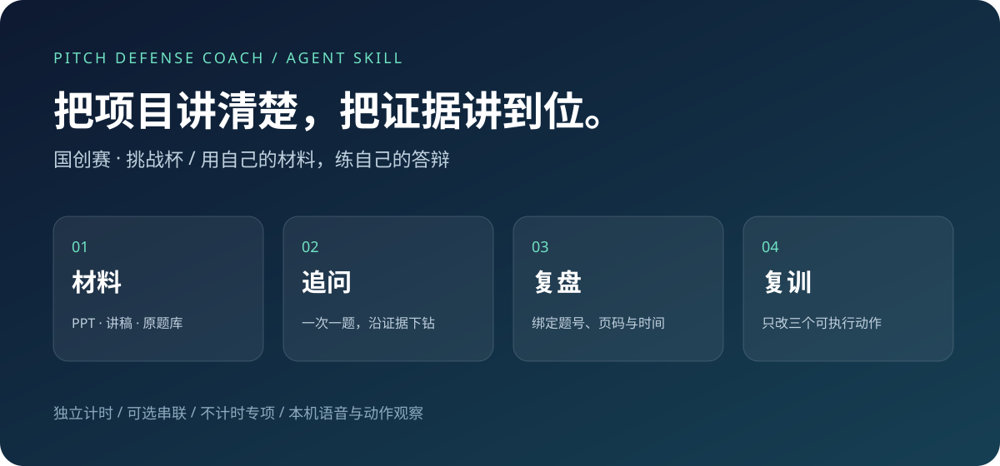
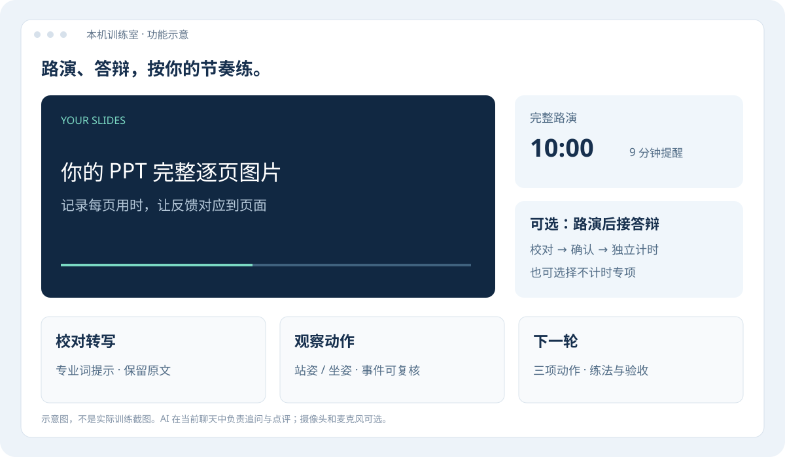

<div align="center">

# 答辩与路演教练

**Pitch Defense Coach · 面向国创赛、挑战杯与三创赛的 AI Skill**

上传项目 PPT 即可开始；讲稿、已有题库和赛事要求可选补充。

[快速开始](#快速开始) · [训练模式](#训练模式) · [赛事适配](#赛事适配) · [隐私说明](#隐私说明) · [MIT](LICENSE)



</div>

**让评委听懂：为什么值得做，方法好在哪里，证据证明了什么。**

AI 从你的材料出发，一次只问一个问题，沿着回答继续追问。可选的本机训练室提供逐页路演、分别计时、录音转写与摄像头动作观察。练完后，反馈落到具体题号、页码和下一轮能改的三个动作。

教练优先使用你的原题库，找到“只有结论、缺少依据”的地方。材料没有的数据、案例和亲历故事，标为 **证据缺口**，不代写成事实。


## 新增：三创赛模拟

支持全国大学生电子商务“创新、创意及创业”挑战赛（三创赛）。常规赛按创新、创意、创业、演讲、文案复盘；实战赛进一步区分创业准备、创业过程和创业成绩，并核对相应专项指南。

- 页面可选“三创赛 · 常规赛 / 实战赛”，预置 **8分钟路演＋独立7分钟问答**，按第17届通则参考配置；具体届次、赛段和限时以用户通知为准。
- 串联仍由使用者选择；终极赛一般只路演，额外问答作为加练。不计时专项继续可用。
- 问题优先下钻：谁使用谁付费、一笔交易怎样完成、GMV与收入如何区分、获客和履约是否算进成本、运营调整的证据、学生实际贡献。
- **不要求先准备题库。** 有原题就优先用原题，没有就从PPT或摘要生成有出处的教练问题。
- 路演连续计时；问答排除等待教练和转写时间，是有效训练时长，不冒充真实现场全程计时。

示例：
```text
使用 $pitch-defense-coach。我参加第17届三创赛常规赛小组赛。
我只有PPT，没有题库。请从材料找出两条证据薄弱链，
先做8分钟路演，再接7分钟问答，每次只问一个问题。
```

[规则与训练标准](skills/pitch-defense-coach/references/sanchuang.md) · [往届视频片段与观察边界](skills/pitch-defense-coach/references/sanchuang-cases.md)


## 快速开始

把下面这段话交给支持本地文件与命令执行的 AI Agent：

```text
请安装答辩与路演教练 Skill：
https://github.com/Luckyjacky-Cyber/pitch-defense-coach
先阅读仓库说明，将 skills/pitch-defense-coach 安装到当前宿主的技能目录。
为我的项目创建独立训练实例，保留已有文件，不覆盖原材料。
```

安装后，提供自己的 PPT 或项目摘要；讲稿、题库和赛事要求可选，然后说：

```text
使用 $pitch-defense-coach。
我参加国创赛，数据以最新 PPT 为准，优先使用我的原题库。
先识别两条证据薄弱链，再开始 5 分钟模拟答辩，每次只问一题。
```

也可以从专项开始：

```text
使用 $pitch-defense-coach。我参加挑战杯学术科技作品竞赛。
本轮不计时，只练“核心创新与对照实验”，不要替我编造实验数据。
```

<details>
<summary><strong>手动安装与运行条件</strong></summary>

```bash
git clone https://github.com/Luckyjacky-Cyber/pitch-defense-coach.git
cd pitch-defense-coach
python install.py
```

脚本默认安装到 Codex 的 skills 目录；同名 Skill 已存在时停止，不覆盖。其他兼容宿主可用 `--skills-dir <宿主技能目录>`，或手动复制整个 `skills/pitch-defense-coach` 文件夹，再按宿主要求重新加载。

- 基本训练室：Python 3.10+，建议 Chrome / Edge；文字与计时只用 Python 标准库。
- AI 教练：宿主需能读取材料、运行本地命令。不同宿主的 PPT/PDF 解析、OCR、浏览器权限不同。
- 语音与动作分析：可选安装，首次联网下载依赖与模型；模型在本机运行。
- 本项目主要在 Windows 验证；macOS/Linux 尚未完成整套真人体验验证。
- 网页不自带大模型后端，由当前 AI 会话出题和点评；无需为网页另配 AI API 密钥，宿主本身的账户和费用仍按其规则。

仅把 SKILL.md 粘贴进普通聊天，不会自动获得本机工具、摄像头或文件访问能力。

</details>

## 训练模式

| 想练什么 | 怎么练 | 时间规则 |
| --- | --- | --- |
| 完整路演 | 展示自己的 PPT 逐页图片，记录每页停留与讲述 | 默认 10 分钟，三创赛预置 8 分钟；可选 1—30 分钟，剩 1 分钟提醒 |
| 模拟答辩 | 一次一题，根据回答下钻或切换维度 | 可选 3 / 5 / 7 / 8 / 10 / 12 分钟；等待教练、转写时不扣答题时间 |
| 路演接答辩 | 自主勾选串联；先校对，再确认进入答辩 | 两段分别计时，围绕刚才的路演追问 |
| 不计时专项 | 选一个薄弱环节，或从指定页开始反复讲 | 无倒计时、无自动截止，主动结束后复盘 |

串联并非必须开启。交接后会建立独立答辩轮次，出题仍由当前 AI 教练完成。完整路演可在页面调整时长。三创赛预置 8 分钟路演与 7 分钟答辩；实际以当届、当赛段通知为准，大组赛通常不答辩，不自动串联。

## 赛事适配

| 方向 | 训练重点 |
| --- | --- |
| 中国国际大学生创新大赛（国创赛） | 专业学习与项目的连接、学生实际工作、创新验证、产业或社会价值、团队协作 |
| 挑战杯 · 学术科技作品 | 研究问题、方法与对照、样本或实验可靠性、创新贡献、学生独立工作 |
| 三创赛 · 常规赛 / 实战赛 | 创新、创意、创业证据与电商业务闭环；实战赛进一步区分创业准备、过程和成绩 |
| 挑战杯 · 创业计划 | 需求证据、产品与服务创新、实践验证、交付与成本、持续发展、团队贡献 |

按届次、赛道与组别配置，不把学术作品强行套成融资答辩，不把成熟创业项目的收入门槛套到早期创意项目。默认给 **强 / 中 / 弱 / 缺失** 的证据等级；官方权重需核验当届文件。详见 [赛事配置](skills/pitch-defense-coach/references/competition-profiles.md)。

## 一轮训练会发生什么

1. **读材料。** 把主张对应到 PPT 页码、原题号、单位和测试条件。
2. **找薄弱链。** 至少识别两个缺少依据的连接，例如“性能更好”是否真的支持“成本更低”。
3. **逐题追问。** 回答具体则深入验证，回答充分则切换，不机械施压。
4. **校对并复盘。** 对照实际回答、逐页用时与可复核动作，确定三项复训动作。

下面是**虚构练习片段，仅展示追问方式**：

> **材料主张：**“我们能显著降低客户成本。”  
> **教练：**“相较客户目前的处理方式，降低的是哪项成本？”  
> **学生：**“我们的材料性能更好，用量更少。”  
> **教练：**“支持用量减少的同条件对照证据是什么？”

材料没有成本核算，就保留已经证明的性能优势，把成本结论列为待验证，不补一个看似合理的降幅。

复盘区分三件事：

- **内容：** 回答是否对题？证据是否支持结论？预测与实绩有没有混淆？
- **逻辑：** 从专业认知、方法到验证与价值，哪一步缺少连接？
- **可观察动作：** 哪个 Q 号或 P 页出现了什么事件，持续多久，是否有可靠观测依据？

动作反馈不能变成“紧张 7 分”。可执行建议应类似“把对照条件写进首句，45 秒内重答两遍”。需要新实验才能填补的缺口另列，不冒充一晚能练出来的能力。

另附公开总决赛片段的 [案例观察](skills/pitch-defense-coach/references/case-driven-coaching.md) 与 [讲述标准](skills/pitch-defense-coach/references/performance-standards.md)，标明抽样位置、AI 字幕误差，不充当官方评分规则。

## 本机训练室



*功能示意图，不含用户材料或训练记录。*

支持站姿和坐姿校准。远距离脸部太小时可只观察身体。转写支持 Whisper tiny / small、自定义术语、原文保留和人工校对。不开摄像头或麦克风，也能练文字回答与计时。

<details>
<summary><strong>手动启动、导入 PPT、安装可选模型</strong></summary>

在仓库目录运行：

```bash
python skills/pitch-defense-coach/scripts/bootstrap.py --target local-projects/my-project
python local-projects/my-project/server.py --port 8769
```

打开 `http://127.0.0.1:8769/`。此时只有占位页，尚未导入项目。保持服务运行；关闭终端或重启电脑后需重新启动。

从 PowerPoint 等软件导出**完整逐页图片**，按 `01.png、02.png……` 命名。停止服务后导入：

```bash
python skills/pitch-defense-coach/scripts/import_slides.py --app local-projects/my-project --images YOUR_SLIDE_IMAGES --source YOUR_PROJECT.pptx
```

重启并核对页数、顺序、文字。静态图片不保留动画和视频。这里没有网页文件上传平台，PPT/Word/PDF 阅读与证据整理交给 AI Agent 及宿主可用工具，详见 [材料规范](skills/pitch-defense-coach/references/materials.md)。

可选安装动作分析与语音转写：

```bash
python skills/pitch-defense-coach/scripts/setup_optional.py --app local-projects/my-project --vision
python skills/pitch-defense-coach/scripts/setup_optional.py --app local-projects/my-project --asr tiny
python local-projects/my-project/launch.py --roadshow
```

安装后停止旧服务，再用 launch.py 选择项目虚拟环境启动。tiny 较轻量；small 通常更准，但下载和 CPU 转写更慢。口音、术语和数字仍需校对，术语提示不会静默修改数字和单位。排错见 [本机部署](skills/pitch-defense-coach/references/local-tool.md)。

</details>

## 隐私说明

**公开的是教练和工具模板，自己的项目放在独立本机实例中。** 仓库不含原项目 PPT、题库、照片、录音或训练记录。

| 数据 | 去向 |
| --- | --- |
| 摄像头原始画面 | 浏览器内分析，不上传服务器 |
| 麦克风音频 | 发往本机服务转写；本轮可下载录音，刷新可能丢失未下载录音 |
| 转写、校对文本、事件摘要 | 本机保存；被 AI 教练读取的部分进入当前 AI 会话 |
| 用户 PPT、题库、项目事实 | 导入独立实例；交给 AI 的材料受对应宿主的数据政策约束 |

本机视频分析不等于整个训练过程完全离线。不要把导入私人材料的实例上传 GitHub；.gitignore 已排除常见数据、录音和模型目录，分享前仍应核对文件清单。

动作检测是可复核的启发式观察，不判断焦虑、自信、诚信或人格；脸部方向不是精确眼球追踪。未校准、光照不足、识别失败的通道应显示“未观察”。

## 赛前 30 分钟

| 时间 | 只做这件事 |
| --- | --- |
| 0—3 分钟 | 核对材料版本，检查录音与校准，或直接仅文字 |
| 3—5 分钟 | 锁定两条薄弱链，找到数据出处 |
| 5—15 分钟 | 完成一轮路演或答辩 |
| 15—20 分钟 | 校对数字，查看具体题目或页码反馈 |
| 20—27 分钟 | 只练三个优先动作，每个重答两遍 |
| 27—30 分钟 | 复核数据卡：单位、条件、出处、适用范围 |

## 开发与贡献

```text
skills/pitch-defense-coach/
├── SKILL.md           # Agent 执行指令
├── references/        # 赛事配置、证据规范、追问与复盘协议
├── scripts/           # 独立实例、图片导入、可选模型安装
├── assets/app/        # 本机网页与服务模板
└── tests/             # API、计时、摄像头与模型选择回归
```

检查命令（Python 3.10+；前端测试需 Node.js 18+）：

```bash
python skills/pitch-defense-coach/tests/run_tests.py
node skills/pitch-defense-coach/tests/test_camera.mjs
node skills/pitch-defense-coach/tests/test_posture.mjs
node skills/pitch-defense-coach/tests/test_asr_choice.mjs
```

测试使用临时实例，覆盖导入、覆盖保护、计时截止与恢复、串联、专项、API 流程、同源限制和合成摄像头数据。不等于口音识别或真人动作准确率评测。

欢迎 Issue / PR，提供复现步骤与匿名案例。请勿提交真实参赛材料、客户信息、录音、密钥或未授权肖像，优先使用最小化虚构示例。

## 许可

[MIT License](LICENSE) © 2026 Luckyjacky-Cyber。

仓库不打包第三方模型与浏览器运行库。可选安装会下载 MediaPipe、faster-whisper、Whisper 模型等资源，许可按上游项目执行；本仓库 MIT 许可不替代第三方许可。
